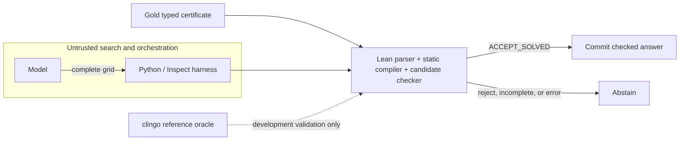

# SparseIR

**The model searches, Lean checks, and the system commits only when the check passes.**

SparseIR is an experimental research project investigating selective prediction for
model-generated reasoning: can an independent, deterministic checker turn silent
wrong answers into explicit abstentions without becoming the solver itself?

> **Status: preliminary Mode-0 evidence.** A model emits one complete candidate
> grid and Lean performs one end-only check. There is no feedback, repair, or retry
> in the reported experiments. Stepwise reasoning and the broader SparseIR pipeline
> remain future work.

[Architecture](docs/architecture.md) · [Experiments](docs/experiments.md) ·
[Verification](docs/verification.md) · [Reproduction](docs/reproduction.md) ·
[Research roadmap](docs/research-roadmap.md)

## Research question

Reasoning systems face two decisions: **search** for an answer and **commit** to
returning it. Average accuracy alone hides complete-but-wrong answers that an
unchecked system would silently trust. Model self-confidence need not identify
those failures: qwen3-8B was wrong on **18 of 31 answers rated at least 90% likely
to be correct** in the recorded confidence experiment.

SparseIR separates search from commitment. The current domain is ZebraLogicBench
logic-grid puzzles, using **gold certificates**: dataset-derived structured puzzle
representations that isolate candidate checking from natural-language parsing.
The checker changes the commit decision; it does not make the model smarter.

## Architecture and trust boundary



Lean checks completeness, category bijections, and every compiled clue predicate.
It does not search for assignments, consult the expected answer, or repair grids.
Models, provider APIs, Python orchestration, and the clingo development oracle are
outside the trusted decision path. Only `ACCEPT_SOLVED` licenses a Mode-0 commit.
A rejected candidate is retained as evidence; the system returns no answer for it.

**The guarantee is “this answer satisfies this certificate,” not “this certificate
captures human intent.”** Model reasoning text is untrusted and is not verified.
See [checker semantics and faithfulness](docs/verification.md).

## Implemented contributions

| Component | Current state |
|---|---|
| Lean JSON parser and static compiler | Strict parsing and well-formedness checks with structured diagnostics |
| Complete-candidate checker | Mode-0 completeness, bijection, and all ten clue predicates |
| Independent validation | Candidate semantics compared against a development-only clingo encoding |
| Evaluation harness | Provider calls, extraction, Lean verdicts, separated failures, costs, and aggregate metrics |
| Trace parser | Frozen Stage 4 JSON → Trace AST contract; **parseability only**, not replay |
| Step kernel | Local operations implemented; stepwise semantic validation remains incomplete on this branch |
| Trusted human audit renderer | `Pretty.lean` is a stub (`available := false`) |
| Feedback, repair, retry, NL-to-certificate pipeline | Not demonstrated end to end |

Raw provider outputs were retained before parsing during experiments. Public
Stage 6 artifacts retain configurations, candidates, verdicts, failures, and
metrics, but not the raw provider response files referenced by their rows.
The [architecture guide](docs/architecture.md) includes an acceptance/rejection
example, component map, and the distinction between current and target systems.

## Recorded findings

### Capability ladder: complete-but-wrong answers are checkable

Each model attempted the same balanced **200-puzzle** subset.

| Model | Solved / 200 | Coverage | Wrong complete candidates¹ | Observed committed error |
|---|---:|---:|---:|---:|
| qwen3-8B | 128 | 64.0% | 53 / 181 = 29.3% | 0% |
| qwen3-32B | 146 | 73.0% | 39 / 185 = 21.1% | 0% |
| deepseek-v4-flash | 196 | 98.0% | 0 / 196 = 0% | 0% |

¹ Clue-violating / (solved + clue-violating), excluding malformed and structurally
invalid candidates. This is answer behavior, not an elicited confidence score.

[Capability-ladder figure](report_assets/fig_verifier_value_scaling.png) (the same recorded comparison).

### Confidence, difficulty, and the residual tail

- **Self-confidence:** at P(True) ≥ 0.9, qwen3-8B was wrong on **18/31** answers
  (58.1%); qwen3-32B on **13/139** (9.4%). v4-flash had no errors among 18 such
  answers but was strongly under-confident: mean P(True) 0.106 and at most 13.8%
  coverage at the reported positive thresholds, versus Lean's 98% ladder coverage.
- **Reasoning ON/OFF:** v4-flash coverage was **96% ON vs 88% OFF**; six-house
  puzzles fell from 35/40 to 25/40. Intermediate requested token caps were not
  honored, so this is **not** evidence of a graded reasoning-budget effect.
- **Clean 1,000-puzzle run:** v4-flash achieved **959/1,000 accepted**, with
  **10 clue violations and 31 malformed outputs**. The residual wrong-candidate
  rate was 10/969 = 1.0% among parseable candidates; all were rejected.
- **Contamination smoke:** paired original and perturbed solve rates were both
  36/40, with zero observed answer regurgitations. This does not prove absence
  of benchmark contamination.

An earlier **39.5% wrong-among-parseable** v4-flash result was traced to an
approximately 1,800-token output cap, not retained as the headline. Discarded
reasoning-OFF runs, failed cap manipulations, and confidence-call confounds remain
visible in the [detailed results and interpretation](docs/experiments.md).

## Quickstart: inspect the checker offline

Requires the [pinned Lean toolchain](lean-toolchain) and Python 3.11+.
No provider key or external dataset is needed for these public-fixture checks.

```bash
lake build
python3 scripts/run_lean_verifier.py
```

The default request prints verifier information: Mode 0, with stepwise checking,
tactics, and audit view disabled. For actual acceptance/rejection examples, use
the [offline candidate walkthrough](docs/reproduction.md#offline-candidate-walkthrough).

With the Python dependencies available:

```bash
uv sync --dev
uv run pytest tests/test_stage3b_differential_candidates.py
```

This small offline test exercises Lean candidate checking against clingo using a
committed puzzle fixture. Full public-checkout validation, dataset prerequisites,
and credential-requiring provider evaluations are separated in the
[reproduction guide](docs/reproduction.md).

## Research boundaries and next questions

The observed **0% committed error** is conditional on these finite runs, the
supplied certificates, and the implemented checker semantics. Correctness labels
in the Mode-0 metrics are themselves Lean verdicts, not independent evidence of
natural-language truth. Abstention lowers coverage; it does not recover an answer.

This is not general verification of language-model reasoning, verified
chain-of-thought, natural-language-to-formal faithfulness, or demonstrated cost
superiority. The small single-shot cheap/frontier cost probe is directional only.
Stronger uncertainty baselines, multiple seeds, harder domains, and end-to-end
cost accounting remain necessary.

The next decisive comparison is **Mode 1 versus budget-matched best-of-N**:
does first-failure feedback help more than blind resampling? It requires trusted
trace replay and stronger stepwise validation first. Human audit also depends on
building a Lean-rendered certificate view from the same AST that is checked.
See the [research roadmap and falsification criteria](docs/research-roadmap.md).

## Documentation and source

| Guide | Contents |
|---|---|
| [Architecture](docs/architecture.md) | Data flow, example puzzle, components, current versus target pipeline |
| [Verification](docs/verification.md) | Trust boundary, checker guarantees, faithfulness, limitations |
| [Experiments](docs/experiments.md) | Metrics, model comparisons, figures, negative results, corrections |
| [Reproduction](docs/reproduction.md) | Evidence index, offline checks, dataset-backed and provider-backed commands |
| [Research roadmap](docs/research-roadmap.md) | Completed scope, open hypotheses, next experiments |

Source is published for research transparency; see [NOTICE.md](NOTICE.md) for
reuse restrictions and third-party dataset attribution.
