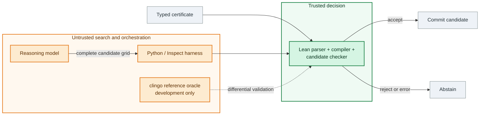
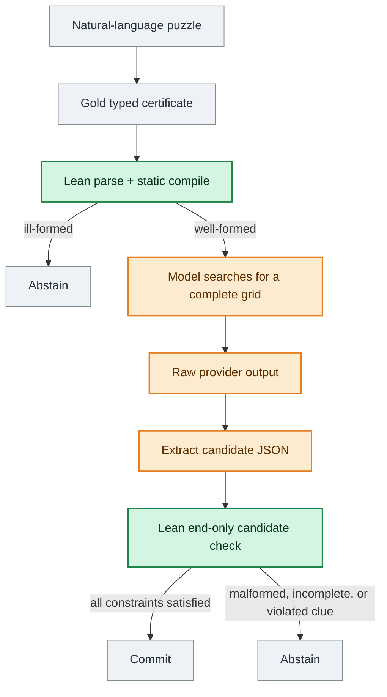
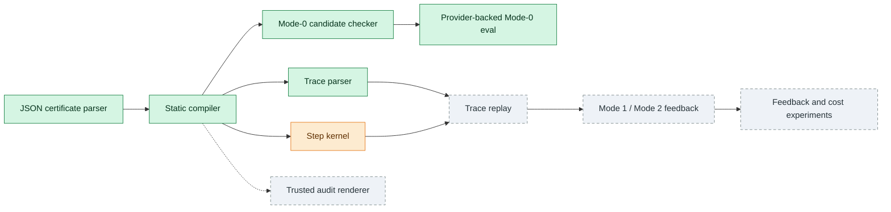

# Architecture

[Home](../README.md) · [Architecture](architecture.md) · [Experiments](experiments.md) · [Verification](verification.md) · [Reproduction](reproduction.md) · [Roadmap](research-roadmap.md)

## What is built today?

| Component | Status | What that means |
|---|---|---|
| Lean JSON parser and static compiler | **Built and tested** | Reject malformed or ill-formed certificates before checking a candidate. |
| Lean complete-candidate checker | **Built and evaluated** | Checks completeness, bijections, and all clue predicates for a supplied grid. This is the Mode-0 path used in the reported results. |
| Candidate-level clingo differential validation | **Built** | Independently compares candidate semantics against an ASP encoding during development. clingo is not in the runtime trust boundary. |
| Provider-backed evaluation harness | **Built and run** | Stores prompts, raw provider output, parsed candidates, Lean verdicts, failures, and aggregate metrics. |
| Step kernel | **Implemented, incompletely validated** | Supports local operations, but its evidence is example-based rather than a complete candidate-style differential gate. |
| Trace parser (lower JSON → Trace AST) | **Built and frozen (Stage 4)** | Frozen contract: `parse_trace` lowers a trace JSON object into a `Trace` AST and returns a structured 26-code error taxonomy. The public justification shape is a tagged union: `{clue, from?}` or `{rule: bijection, from?}` (no private kernel rule names). Replay of the parsed trace and semantic stepwise checking are **not** implemented; no end-to-end Mode-1 or Mode-2 result is claimed. The parser does not require `conclude` — that is a Stage 5 / replay concern. |
| Verifier-guided feedback and repair | **Not built** | The central feedback-granularity experiment remains future work. |
| Natural-language to certificate parser | **Not built/evaluated end to end** | Current experiments start from gold certificates. |
| Trusted human audit renderer (`Pretty.lean`) | **Stub** | `available := false`; this is a load-bearing missing component for the faithfulness story. |

## A tiny example

A ZebraLogic puzzle is a logic-grid puzzle. Houses occupy fixed positions, and each category assigns exactly one of its values to each house. The model's job is to search for a complete grid that satisfies every clue.

| House | Color | Drink |
|---:|---|---|
| 1 | ? | ? |
| 2 | ? | ? |
| 3 | ? | ? |

A human-readable certificate for a three-house puzzle might look like this:

```text
houses: 1, 2, 3

categories:
  Color: red, green, blue
  Drink: tea, coffee, milk

clues:
  c1: red is in house 2
  c2: red and tea are in the same house
  c3: green is directly left of red
  c4: blue and milk are in the same house

goal:
  find a complete assignment of Color and Drink to houses
```

A model searches for a complete assignment. One candidate satisfying these clues is:

```text
candidate:
  house 1: green, coffee
  house 2: red, tea
  house 3: blue, milk
```

Lean checks the supplied grid rather than deriving it. This candidate is complete, uses every value exactly once, and satisfies every clue, so the public-facing result can be summarized as:

```text
Lean result:
  ACCEPT_SOLVED
  status: solved
  claim: assignment satisfies all clues of the puzzle
```

If the model instead puts tea in house 1 and coffee in house 2:

```text
candidate:
  house 1: green, tea
  house 2: red, coffee
  house 3: blue, milk
```

Lean rejects the candidate and reports a violated clue:

```text
Lean result:
  REJECT
  status: clue_violation
  violated clue: c2
  message: candidate violates clue c2
```

Clue `c2` requires red and tea to share a house, but the rejected candidate places them in houses 2 and 1. In the current Mode-0 experiments, this is the whole loop: the model emits one complete grid; Lean accepts it or the system abstains. Model reasoning text is untrusted and is not verified. Stepwise traces and verifier-guided repair are not part of the current public result.

Internally, the verifier consumes structured JSON. The certificate above is a manually written illustration of the **intended** human audit rendering of that same structured object; it is not output from a separate parser or from a completed renderer. The trusted audit view must eventually be rendered by Lean from the same parsed AST that the checker verifies. `Pretty.lean`, the component intended to do that, is still a stub.

## How it works

### Trust boundary

Only Lean decides whether a candidate is accepted. Models, Python orchestration, provider APIs, prompts, and the development oracle are untrusted.



Green marks the trusted Lean decision path; orange marks components that may be wrong but cannot override a rejection.

The dataset's expected solution is not part of the acceptance decision. Evaluation labels are applied after the raw output and Lean verdict have been recorded. Python cannot override a Lean rejection.

### Current Mode-0 data flow



The natural-language-to-certificate arrow is intentionally not claimed as a built model pipeline. Gold certificates isolate the candidate-checking experiment from semantic parsing errors.

### Checker, not solver

For a supplied grid, Lean checks that every category is a bijection over houses and that each typed clue predicate is satisfied. It does not enumerate assignments, call a solver, consult the gold answer, or repair the grid. This asymmetry keeps the trusted decision small and inspectable.

Candidate-level clue semantics were tested against an independent clingo encoding. That differential test is evidence about this bounded implementation; it is not a proof that the certificate matches human intent, nor does it establish the same validation depth for stepwise operations.

## Current implementation and target architecture



Mode 0 gates a completed answer. The target system adds two feedback regimes: Mode 1 would replay a complete trace and return the first invalid step; Mode 2 would check one operation at a time. Neither repair loop has been demonstrated.

## Repository map

| Path | Role |
|---|---|
| `SparseIRLean/Json.lean` | Strict problem-envelope and certificate parsing |
| `SparseIRLean/Compiler.lean` | Static checks and compilation to the internal puzzle form |
| `SparseIRLean/CheckerCore.lean` | Complete-candidate Mode-0 semantics |
| `SparseIRLean/StepKernel.lean` | Implemented local step operations; not integrated into Mode 1/2 replay |
| `SparseIRLean/Trace.lean` | Frozen trace parser (Stage 4) — `parse_trace` lowers a trace JSON into a `Trace` AST and returns a structured 26-code error taxonomy. The public justification shape is a tagged union (`{clue, from?}` or `{rule: bijection, from?}`). |
| `SparseIRLean/Main.lean` | Fail-closed JSON CLI |
| `SparseIRLean/Pretty.lean` | Trusted audit-renderer stub |
| `src/sparseir_harness/` | Untrusted datasets, orchestration, scoring, and reference tooling |
| `eval/gates/` | Committed experiment configurations, outputs, metrics, and summaries |
| `tests/` | Interface, checker, differential, dataset, and harness tests |
