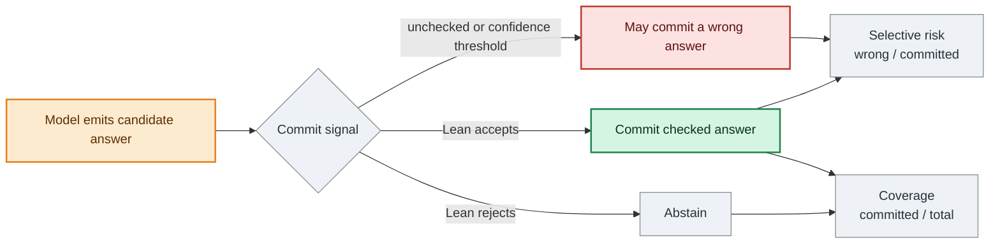
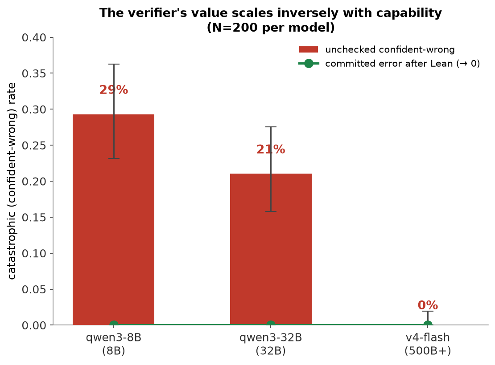
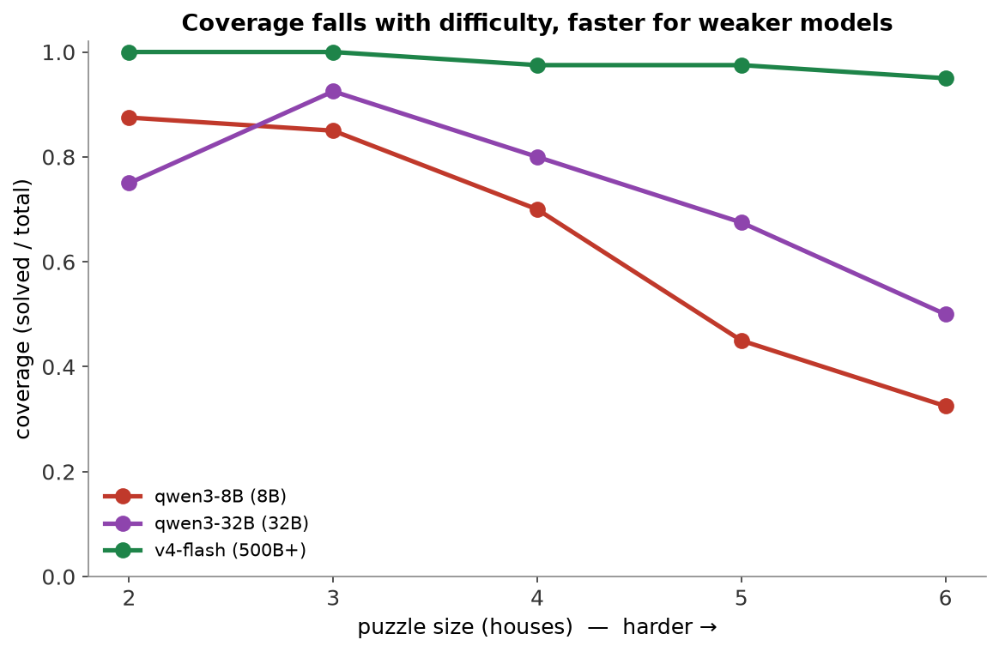

# Experiments and evidence

[Home](../README.md) · [Architecture](architecture.md) · [Experiments](experiments.md) · [Verification](verification.md) · [Reproduction](reproduction.md) · [Roadmap](research-roadmap.md)

## Metrics

- **Coverage:** fraction of examples where Lean accepts and the system commits the candidate.
- **Confident-wrong:** a parseable candidate emitted as the model's answer that violates the certificate and would have been committed without Lean. This measures answer behavior, not elicited confidence.
- **High-confidence wrong:** an answer that is wrong despite the model assigning it a high P(True), reported here at the ≥0.9 threshold.
- **Committed error:** wrong answers among candidates accepted by Lean.
- **Abstention:** any malformed, incomplete, clue-violating, or otherwise rejected output.

Different commit signals select different operating points: stricter gating can reduce selective risk by abstaining more often, at the cost of coverage.

## Preliminary Mode-0 findings

All headline runs use gold certificates and one end-only Lean check.

### Capability ladder

| Model | Solved / 200 | Coverage | Confident-wrong among parseable answers | Committed error after Lean |
|---|---:|---:|---:|---:|
| qwen3-8B | 128 | 64.0% | 53 / 181 = **29.3%** | **0%** |
| qwen3-32B | 146 | 73.0% | 39 / 185 = **21.1%** | **0%** |
| deepseek-v4-flash | 196 | 98.0% | 0 / 196 = **0%** | **0%** |

The v4-flash ladder result should not be read as proof of zero tail risk. A separate clean 1,000-puzzle run measured 95.9% coverage and about **1.0% confident-wrong among parseable answers**. The ladder was too easy to expose that small tail reliably.

### High-confidence answers were often wrong

A separate call elicited **P(True)**, the model's estimate that its own answer was correct.

| Model | Answers with P(True) ≥ 0.9 | Wrong among them | Interpretation |
|---|---:|---:|---|
| qwen3-8B | 31 | **18 / 31 = 58.1%** | High confidence was anti-informative; raising the threshold did not recover Lean's zero-risk point. |
| qwen3-32B | 139 | **13 / 139 = 9.4%** | Confidence was weak/flat, and the call was confounded by partial re-reasoning. |
| v4-flash | 18 | **0 / 18 = 0%** | The model was strongly under-confident, so confidence thresholds could not approach Lean's coverage. |

For v4-flash, mean P(True) was 0.106 and even the lowest reported threshold covered only 13.8% of parseable rows, far below Lean's 98% coverage. The absence of high-confidence errors on this ladder therefore does not make its confidence useful as a matched-coverage commit signal.

P(True) is a deliberately limited baseline, not the strongest possible uncertainty method. Log-probability, consistency, and learned confidence baselines remain to be tested.

### Reasoning ON vs OFF, not a graded cap experiment

The provider did not honor the requested intermediate maximum reasoning-token settings. The apparent cap sweep therefore cannot support a graded reasoning-budget claim. The valid comparison is only **reasoning ON vs reasoning OFF**.

With reasoning OFF, v4-flash coverage was 88%; with reasoning ON, it was 96%. The effect was concentrated on harder puzzles: 2–3-house puzzles remained 40/40 in both conditions, while 6-house puzzles fell from 35/40 with reasoning ON to 25/40 with reasoning OFF. Confident-wrong rates rose primarily on 5–6-house grids. Across the capability ladder, coverage also fell faster with grid size for lower-capability models. Together these results suggest that errors appear where the model is outmatched, but they do not establish a dose-response curve for reasoning tokens.

### Contamination smoke

Forty puzzles were transformed by renaming values and permuting house order, then rechecked for uniqueness. The transformed and paired-original solve rates were both 36/40, with zero observed regurgitations of the original answer. This removes one obvious memorization signature; it does not prove absence of benchmark contamination.

### The earlier dramatic result was a measurement artifact

An earlier v4-flash run reported 39.5% confident-wrong. Investigation traced most of that result to an approximately 1,800-token output cap that truncated reasoning on larger grids. With an adequate output budget, the error rate fell to roughly 1–4%, depending on the run.

That result is not the headline. It is retained as an experimental lesson: output limits were a confound, the diagnosis changed the thesis, and subsequent experiments separated capability, difficulty, and usable reasoning budget more carefully.

## Methodology and denominators

The ladder and budget sweep use the same balanced 200-puzzle subset: eight
puzzles in each of 25 grids (2–6 houses × 2–6 categories). The clean run uses
1,000 uniqueness-checked puzzles, 40 per grid. All use dataset-derived gold
certificates, not predicted natural-language translations. Expected solutions
are excluded from prompts and verifier requests; `ACCEPT_SOLVED` is the sole
correctness judge. Thus “zero committed error” is not an independent test of the
checker's correctness or certificate faithfulness.

The ladder's wrong-complete-answer denominator is **solved + clue violation**:
181, 185, and 196 respectively. It excludes malformed and structurally invalid
candidates, not merely strings that fail JSON parsing. This makes the
complete-but-wrong tail visible without conflating it with formatting failures.

Historical gate metrics sometimes call **all non-solved rows**, including
malformed outputs, “unchecked confident-wrong.” Do not compare that all-row
metric directly with the complete-answer rate above.

## Clean 1,000-puzzle run and rejection accounting

The [reasoning-ON cleanup run](../eval/gates/stage6_mode0_h5_cleanup/summary.md)
records 959 solved, 10 clue violations, and 31 malformed cheap-arm outputs.
Coverage is 95.9%; the all-row unchecked non-solved rate is 41/1,000 = 4.1%;
wrong among parseable candidates is 10/969 = 1.03%. No rejected answer is
committed, and abstention does not repair it.

| Houses | N | Coverage | Non-solved rate | Malformed | Clue violation |
|---:|---:|---:|---:|---:|---:|
| 2 | 200 | 100.0% | 0.0% | 0.0% | 0.0% |
| 3 | 200 | 98.0% | 2.0% | 1.0% | 1.0% |
| 4 | 200 | 98.0% | 2.0% | 1.5% | 0.5% |
| 5 | 200 | 95.0% | 5.0% | 5.0% | 0.0% |
| 6 | 200 | 88.5% | 11.5% | 8.0% | 3.5% |

The [metrics](../eval/gates/stage6_mode0_h5_cleanup/metrics.json) retain Wilson
95% intervals and secondary per-grid results. The six-house tail includes
timeouts and reasoning-budget exhaustion, not just complete wrong grids.
Reasoning tokens were positive in 97.8% of cheap generations, with median 2,314.

### Directional single-shot cost probe, not established H5 superiority

On a paired **30-puzzle** subset, both cheap+Lean and frontier+Lean solved 30/30:

| Arm | Total provider cost | Cost / verified correct |
|---|---:|---:|
| deepseek-v4-flash + Lean | $0.0410 | $0.0014 |
| Claude Opus 4.8 + Lean | $1.2425 | $0.0414 |

Both used reasoning ON; the frontier results were reused unchanged from the
prior valid run. This is a small, directional single-shot comparison, not a
retry/feedback experiment or established end-to-end cost advantage. Cheap
coverage remains capped by its raw solve rate. Parsing, audit, checking, retries,
abstentions, and stronger baselines still need matched-cost evaluation.

## Corrections and provenance notes

- The [200-puzzle pilot](../eval/gates/stage6_mode0_h2_h3/summary.md) accepted
  92 answers, rejected 60 clue violations, and had 48 malformed outputs.
  Its 39.5% figure is **60/152 parseable candidates**, whereas its recorded
  all-row unchecked wrong rate is 108/200 = 54.0%. The historical harness
  default in [stage6_mode0.py](../src/sparseir_harness/stage6_mode0.py) is an
  1,800-token generation cap. The truncation-confounded interpretation was
  withdrawn rather than promoted as verifier value.
- The [discarded reasoning-OFF run](../eval/gates/stage6_mode0_h5_cleanup/run_reasoning_off_discarded/summary.md)
  had 8.9% coverage, 91.1% unchecked non-solved rate, and only 5.9% of generations
  with positive reasoning tokens. Its 0.3% malformed rate was not an improvement:
  suppressing reasoning produced short, well-formed but wrong answers. The clean
  reasoning-ON run restored coverage to 95.9%, with 3.1% malformed outputs.
  A separate [discarded 4,096-total-cap result set](../eval/gates/stage6_mode0_h5_cleanup/run_discarded_4096_total_cap/results.jsonl)
  is also retained, rather than removed from the research history.
- The budget-sweep summary's original “coverage as a function of reasoning
  budget” wording is too strong: requested intermediate caps were not honored.
  Its recorded token maxima justify only the ON/OFF interpretation above.
- The H3 gate reports **63.5%** Lean coverage for qwen3-8B, versus **64.0%**
  in the ladder. Despite its “reused verbatim” description, two stored rows
  differ: `zl_lgp-test-2x6-20` and `zl_lgp-test-4x4-32` become malformed in H3
  (previously clue-violating and solved). The ladder table retains the ladder
  counts; confidence findings use H3's own rows. This discrepancy is not silently
  reconciled or used to imply matched coverage that was not recorded.
- Raw Stage 6 provider files named by `raw_path` are absent from the public
  checkout. Parsed candidates, verdicts, failures, configurations, and metrics
  remain committed; historical provider generations are not bit-reproducible.

## Validation evidence beyond model scores

The [static compilation gate](../eval/gates/stage2_gate_a_compile_all/summary.md)
records 1,000 compiled puzzles and zero failures. Its
[audit](../eval/gates/stage2_gate_a_compile_all_audit/summary.md) found no errors
or warnings. [Mutation rejection](../eval/gates/stage2_gate_b_mutation_rejections/summary.md)
rejected 27/27 malformed certificates, and
[broader fuzzing](../eval/gates/stage2_gate_b_plus_fuzz/summary.md) rejected
22,042/22,042 mutations while compiling 2,495/2,495 controls. These are bounded
implementation checks, not formal proofs of semantic correctness.

The existing [Stage 4 freeze record](../eval/gates/stage4_trace_parser/FREEZE.md)
remains the detailed parser reference: 3,028 traces, including **28 malformed
fixtures exercising all 26 error codes**, plus 122 Schema/Lean boundary cases
with zero disagreements. Stored provider evidence includes 140 positive and
120 adversarial samples. The 36-attempt stepwise diagnostic returned text in
35 cases and parsed in 20/35; no private rule names leaked in returned outputs.
This is **parseability only**, not semantic replay, solve accuracy, or Mode 1/2.
