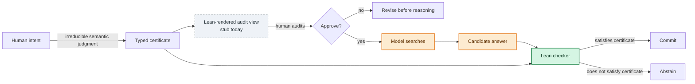

# Verification and trust

[Home](../README.md) · [Architecture](architecture.md) · [Experiments](experiments.md) · [Verification](verification.md) · [Reproduction](reproduction.md) · [Roadmap](research-roadmap.md)

## What SparseIR is testing

Reasoning systems have two separate decisions:

1. **Search:** produce a candidate answer.
2. **Commit:** decide whether that answer is safe to return.

SparseIR separates them. An untrusted model performs the expensive search. A small Lean program performs a finite check over the candidate and certificate. If the check succeeds, the system commits; otherwise it abstains.

The research question is not whether Lean can solve the puzzle. It does not search. The question is whether a checker can provide a better commit signal than the model's own confidence, and later whether structured feedback can repair failures efficiently.

The checker's value is largest where the model has a non-trivial silent-error rate: lower-capability models, harder instances, or constrained compute. At the frontier on easy instances, it may be mostly overhead; the open question is where the silent tail begins and what kind of failures appear there.

## Why this matters: tail risk, not average accuracy

SparseIR is aimed at the expensive failure mode: a model gives a complete answer that an unchecked system would commit, and that answer is wrong with no usable warning.

Average accuracy hides that failure. A model can be highly accurate and still be risky in settings where the remaining failures are hard to identify and costly to trust. The relevant question is not only “how often is the model right?” but “when it is wrong, does the system know not to commit?”

SparseIR changes that failure mode. The checker does not make the model smarter and does not find the answer itself. It turns some silent wrong answers into explicit abstentions. In this README's Mode-0 result, the check is only an end gate; the larger project asks whether verifier feedback can also repair failures rather than merely reject them.

## What Lean guarantees, and what it does not

Given the code and certificate supplied to it, Lean verifies:

- the certificate parses and passes static well-formedness checks;
- the candidate is complete and bijective for the declared grid;
- the candidate satisfies every compiled clue;
- rejection is fail-closed and cannot be overridden by the model or harness.

Lean verifies **“this answer satisfies this certificate.”** It does not verify **“this certificate captures what the human meant.”** Those are different claims.

### Faithfulness and the human audit surface

SparseIR has two different failure layers:

```text
human intent  --framing-->  typed certificate  --reasoning-->  answer
```

Lean can check the second layer: given a certificate, does the candidate answer satisfy it? That is the machine-checkable reasoning tail, and it is the part this README evaluates.

Lean cannot check the first layer: whether the certificate captures what the human meant. A parser can mistranslate a clue while still producing a well-formed certificate, and Lean would then check the wrong formal problem correctly. SparseIR therefore does not claim to solve natural-language-to-formal faithfulness.

The design goal is to relocate that irreducible semantic judgment. Instead of asking a human to audit a long chain-of-thought after the fact, SparseIR should expose a compact typed certificate before reasoning compute is spent. A person can reject the framing early: “no, clue 3 is wrong.” This does not close the faithfulness gap; it moves it to the cheapest and most legible point.

That design depends on the audit view being rendered by the trusted layer. Otherwise a user could approve text that differs from what Lean checks. The intended Lean-rendered view, `Pretty.lean`, is currently a stub. Building it, then measuring whether people detect injected mistranslations or instead become complacent around a “verified” label, is required work rather than polish.



## Why I trust the current result

The conclusion is narrow because the experiment is structured to make overclaiming difficult:

- **Lean is the sole commit judge.** Gold labels and model confidence do not enter acceptance.
- **Raw-output discipline.** Provider output is stored before extraction and scoring; malformed answers remain visible rather than being silently repaired.
- **Label-free checking.** The candidate checker does not read the expected solution.
- **Independent semantic validation.** Candidate clue predicates are differentially tested against clingo, which is development-only and outside the runtime trust boundary.
- **Failure accounting.** Solved, clue-violating, malformed, invalid, provider-failed, and truncated cases are separated.
- **Confounds are reported.** The truncation-confounded headline was withdrawn; the failed intermediate cap manipulation is reported only as reasoning ON vs OFF; and qwen3-32B re-reasoning is an explicit limitation.
- **Artifacts are committed.** Configurations, per-example results, metrics, failures, and summaries are inspectable under `eval/gates/`.

## What this does not claim

SparseIR does not yet show:

- verified chain-of-thought;
- general theorem proving;
- solved natural-language-to-certificate faithfulness;
- stepwise verifier-guided repair;
- **H1:** representation value from SparseIR traces or certificates;
- **H4:** a feedback-granularity result across end-only, first-failure, and stepwise modes;
- **H5:** cost superiority over frontier models;
- a non-Lean trusted backend;
- model self-check as a trusted replacement for Lean;
- a full natural-language parser, certificate audit, trace, and repair pipeline.

It also does not establish a universal zero-error system. The 0% figure is the observed committed error in these finite Mode-0 runs, conditional on the supplied certificate and implemented checker semantics.
